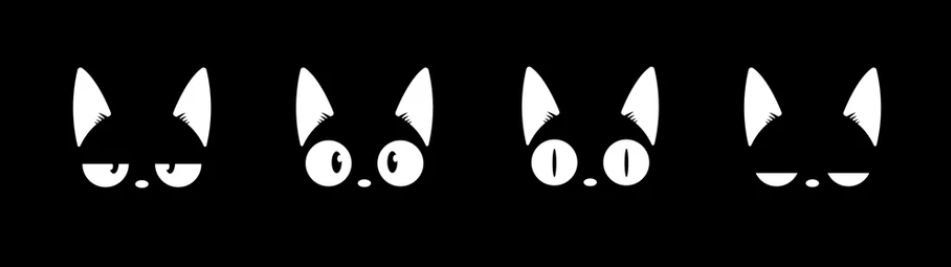
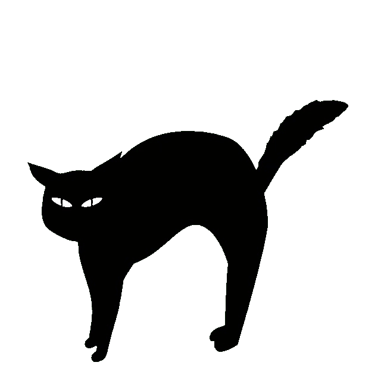

  

    

  

    

  <h1>Mary</h1>

  
Estudante de programação

  
Aprendendo Python e Flask

   

  <h2>Sobre mim</h2>

  

    Idade: 18 anos 
    Cidade: São Paulo - SP 
    Objetivo: Foco, dedicação e aprendizado
  

   

  <h2>Tecnologias</h2>

  

  

    

  <h2>GitHub Stats</h2>

  

    

  

